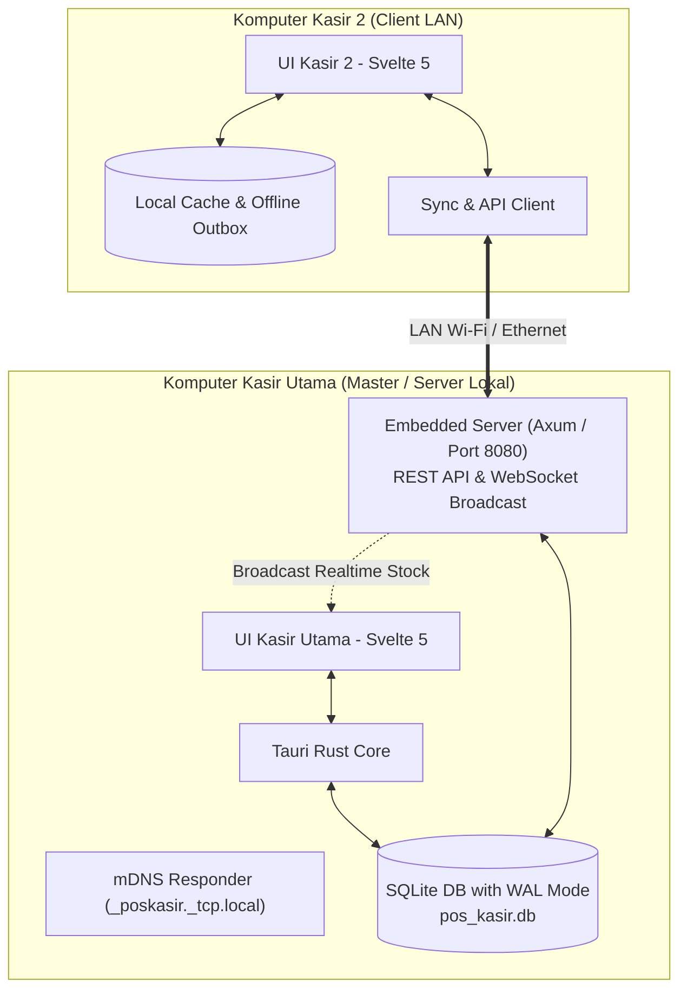

# 01. Arsitektur Sistem & Spesifikasi Tech Stack

## 1. Ikhtisar Arsitektur

Aplikasi POS Kasir Desktop ini dirancang dengan pendekatan **High Performance, Low Memory, Zero-Config LAN**. Sistem berjalan sebagai aplikasi desktop mandiri (*standalone*) sekaligus mampu bertindak sebagai **Server Kasir Utama** bagi komputer kasir klien lain di jaringan lokal tanpa memerlukan instalasi database eksternal (seperti PostgreSQL atau MySQL).

---

## 2. Pilihan Teknologi (Tech Stack)

### A. Desktop Runtime: **Tauri v2 (Rust)**
- **Alasan Pemilihan**:
  - Menggunakan native WebView bawaan OS (Windows: WebView2, Linux: WebKitGTK, macOS: WKWebView).
  - Konsumsi RAM total saat berjalan sangat rendah: **hanya ~35 MB s/d 50 MB** (dibandingkan Electron yang mengonsumsi 180 MB - 250 MB).
  - Ukuran installer sangat kecil (~10 MB - 15 MB).
  - Keamanan memori dan performa konkurensi native dari bahasa Rust.

### B. Frontend Framework: **Svelte 5 (Runes) + Tailwind CSS**
- **Alasan Pemilihan**:
  - Tanpa overhead *Virtual DOM*, Svelte 5 mengompilasi reaktivitas langsung menjadi manipulasi DOM murni.
  - Sangat ramah memori (JavaScript heap di memori < 10 MB).
  - Styling cepat dan modular menggunakan Tailwind CSS.
  - Ikon antarmuka menggunakan pustaka `lucide-svelte`.

### C. Basis Data & Server Lokal: **SQLite (WAL Mode) + Axum (Rust)**
- **SQLite WAL Mode**:
  - `PRAGMA journal_mode = WAL;` (Write-Ahead Logging: pembacaan data tidak pernah mengunci penulisan data).
  - `PRAGMA synchronous = NORMAL;` (performa I/O disk maksimal tanpa risiko korupsi basis data).
  - `PRAGMA busy_timeout = 5000;` (antrean write otomatis hingga 5 detik jika terjadi konkurensi tinggi).
- **Embedded Web Server (Axum)**:
  - Dijalankan langsung di background proses Rust pada PC Kasir Utama (port default: `8080`).
  - Menyediakan endpoint REST API untuk sinkronisasi transaksi dan katalog.
  - Menyediakan saluran WebSocket (`/ws`) untuk memancarkan perubahan stok (*stock broadcast*) ke seluruh kasir secara realtime.
- **Auto-Discovery via mDNS**:
  - Menggunakan protokol mDNS/Zeroconf. PC Kasir Klien otomatis menemukan PC Kasir Utama di jaringan Wi-Fi/LAN yang sama tanpa perlu mengetik alamat IP secara manual.
