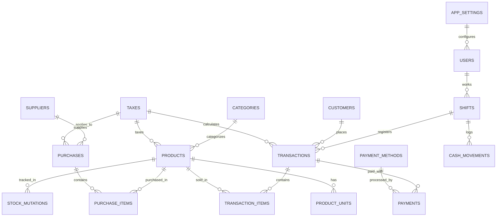

# 02. Skema Basis Data Relasional (SQLite WAL)

Dokumen ini mendefinisikan skema tabel basis data relasional lengkap yang dirancang optimal untuk mesin SQLite dengan mode Write-Ahead Logging (WAL).

---

## 1. Entity-Relationship Diagram (ERD)



---

## 2. Definisi Struktur Tabel (SQL DDL)

```sql
-- ============================================================================
-- 0. MASTER CABANG & STATUS SINKRONISASI PUSAT
-- ============================================================================
CREATE TABLE IF NOT EXISTS branches (
    id TEXT PRIMARY KEY,
    code TEXT UNIQUE NOT NULL, -- 'JKT-01', 'SBY-01', 'BDG-01'
    name TEXT NOT NULL,
    address TEXT,
    phone TEXT,
    is_headquarters INTEGER DEFAULT 0, -- 1 = Kantor Pusat, 0 = Toko Cabang
    api_endpoint TEXT, -- URL API pusat atau IP VPN
    api_key TEXT,
    created_at DATETIME DEFAULT CURRENT_TIMESTAMP
);

-- ============================================================================
-- 1. PENGATURAN TOKO & KONFIGURASI SISTEM DINAMIS
-- ============================================================================
CREATE TABLE IF NOT EXISTS app_settings (
    setting_key TEXT PRIMARY KEY,
    setting_value TEXT NOT NULL,
    setting_group TEXT NOT NULL, -- 'store_profile', 'receipt', 'numbering', 'hardware', 'tax'
    updated_at DATETIME DEFAULT CURRENT_TIMESTAMP
);

-- ============================================================================
-- 2. METODE PEMBAYARAN KUSTOM
-- ============================================================================
CREATE TABLE IF NOT EXISTS payment_methods (
    id TEXT PRIMARY KEY,
    code TEXT UNIQUE NOT NULL, -- 'cash', 'qris_bca', 'transfer_mandiri', dll.
    name TEXT NOT NULL,
    category TEXT CHECK(category IN ('cash', 'bank_transfer', 'ewallet', 'edc', 'other')),
    requires_reference INTEGER DEFAULT 0,
    fee_percentage DECIMAL(5,2) DEFAULT 0,
    is_active INTEGER DEFAULT 1,
    sort_order INTEGER DEFAULT 0
);

-- ============================================================================
-- 3. TARIF PERPAJAKAN
-- ============================================================================
CREATE TABLE IF NOT EXISTS taxes (
    id TEXT PRIMARY KEY,
    name TEXT NOT NULL, -- 'PPN 11%', 'PPN 12%', 'PB1 10%', 'Bebas Pajak'
    rate_percent DECIMAL(5,2) NOT NULL,
    is_default INTEGER DEFAULT 0,
    is_active INTEGER DEFAULT 1
);

-- ============================================================================
-- 4. PENGGUNA, PERAN & HAK AKSES
-- ============================================================================
CREATE TABLE IF NOT EXISTS users (
    id TEXT PRIMARY KEY,
    username TEXT UNIQUE NOT NULL,
    full_name TEXT NOT NULL,
    password_hash TEXT NOT NULL,
    role TEXT NOT NULL CHECK(role IN ('admin', 'supervisor', 'cashier', 'warehouse')),
    pin_code TEXT, -- PIN untuk otorisasi cepat supervisor
    is_active INTEGER DEFAULT 1,
    created_at DATETIME DEFAULT CURRENT_TIMESTAMP
);

-- ============================================================================
-- 5. HULU: PEMASOK & PENGADAAN (PURCHASE ORDER & GOOD RECEIPT)
-- ============================================================================
CREATE TABLE IF NOT EXISTS suppliers (
    id TEXT PRIMARY KEY,
    name TEXT NOT NULL,
    company_name TEXT,
    npwp TEXT,
    phone TEXT,
    address TEXT,
    payment_terms_days INTEGER DEFAULT 0, -- 0 = COD/Tunai, 14 = Tempo 14 hari
    created_at DATETIME DEFAULT CURRENT_TIMESTAMP
);

CREATE TABLE IF NOT EXISTS purchases (
    id TEXT PRIMARY KEY,
    po_number TEXT UNIQUE NOT NULL,
    supplier_id TEXT NOT NULL REFERENCES suppliers(id),
    status TEXT CHECK(status IN ('draft', 'ordered', 'received', 'cancelled')),
    payment_type TEXT CHECK(payment_type IN ('cash', 'credit')),
    due_date DATE,
    subtotal DECIMAL(15,2) NOT NULL,
    tax_id TEXT REFERENCES taxes(id),
    tax_amount DECIMAL(15,2) DEFAULT 0, -- Pajak Masukan
    total_amount DECIMAL(15,2) NOT NULL,
    paid_amount DECIMAL(15,2) DEFAULT 0,
    created_by TEXT REFERENCES users(id),
    created_at DATETIME DEFAULT CURRENT_TIMESTAMP
);

CREATE TABLE IF NOT EXISTS purchase_items (
    id TEXT PRIMARY KEY,
    purchase_id TEXT NOT NULL REFERENCES purchases(id) ON DELETE CASCADE,
    product_id TEXT NOT NULL REFERENCES products(id),
    unit_id TEXT NOT NULL REFERENCES product_units(id),
    multiplier INTEGER NOT NULL, -- Faktor konversi ke satuan dasar
    quantity INTEGER NOT NULL,
    unit_cost DECIMAL(15,2) NOT NULL,
    subtotal DECIMAL(15,2) NOT NULL
);

-- ============================================================================
-- 6. TENGAH: PRODUK, MULTI-SATUAN, TIER HARGA & MUTASI STOK
-- ============================================================================
CREATE TABLE IF NOT EXISTS categories (
    id TEXT PRIMARY KEY,
    name TEXT UNIQUE NOT NULL,
    description TEXT
);

CREATE TABLE IF NOT EXISTS products (
    id TEXT PRIMARY KEY,
    sku TEXT UNIQUE NOT NULL,
    barcode TEXT UNIQUE,
    name TEXT NOT NULL,
    category_id TEXT REFERENCES categories(id),
    min_stock_alert INTEGER DEFAULT 5,
    is_active INTEGER DEFAULT 1,
    is_taxable INTEGER DEFAULT 1, -- 1 = BKP (Kena Pajak), 0 = Non-BKP (Bebas Pajak)
    tax_id TEXT REFERENCES taxes(id),
    base_unit_name TEXT NOT NULL, -- Pcs, Butir, Kg
    created_at DATETIME DEFAULT CURRENT_TIMESTAMP
);

CREATE TABLE IF NOT EXISTS product_units (
    id TEXT PRIMARY KEY,
    product_id TEXT NOT NULL REFERENCES products(id) ON DELETE CASCADE,
    unit_name TEXT NOT NULL, -- Pcs, Pak, Dus
    multiplier INTEGER NOT NULL, -- 1 untuk Pcs, 12 untuk Pak, 48 untuk Dus
    barcode TEXT,
    retail_price DECIMAL(15,2) NOT NULL,
    wholesale_price_1 DECIMAL(15,2),
    wholesale_price_2 DECIMAL(15,2),
    min_qty_wholesale_1 INTEGER DEFAULT 6,
    min_qty_wholesale_2 INTEGER DEFAULT 24
);

CREATE TABLE IF NOT EXISTS stock_mutations (
    id TEXT PRIMARY KEY,
    product_id TEXT NOT NULL REFERENCES products(id),
    mutation_type TEXT CHECK(mutation_type IN ('purchase', 'sale_retail', 'sale_wholesale', 'return_in', 'return_out', 'opname_adj')),
    reference_no TEXT,
    qty_in INTEGER DEFAULT 0,
    qty_out INTEGER DEFAULT 0,
    ending_stock INTEGER NOT NULL,
    note TEXT,
    created_at DATETIME DEFAULT CURRENT_TIMESTAMP
);

-- ============================================================================
-- 7. PELANGGAN, WHOLESALE & PIUTANG (ACCOUNTS RECEIVABLE)
-- ============================================================================
CREATE TABLE IF NOT EXISTS customers (
    id TEXT PRIMARY KEY,
    code TEXT UNIQUE NOT NULL,
    name TEXT NOT NULL,
    npwp_nik TEXT,
    phone TEXT,
    address TEXT,
    customer_type TEXT DEFAULT 'retail' CHECK(customer_type IN ('retail', 'wholesale', 'vip')),
    credit_limit DECIMAL(15,2) DEFAULT 0,
    current_debt DECIMAL(15,2) DEFAULT 0,
    created_at DATETIME DEFAULT CURRENT_TIMESTAMP
);

-- ============================================================================
-- 8. HILIR: SHIFT KASIR & ARUS KAS
-- ============================================================================
CREATE TABLE IF NOT EXISTS shifts (
    id TEXT PRIMARY KEY,
    cashier_id TEXT NOT NULL REFERENCES users(id),
    start_time DATETIME NOT NULL,
    end_time DATETIME,
    starting_cash DECIMAL(15,2) NOT NULL,
    expected_ending_cash DECIMAL(15,2),
    actual_ending_cash DECIMAL(15,2),
    cash_difference DECIMAL(15,2),
    status TEXT DEFAULT 'open' CHECK(status IN ('open', 'closed')),
    notes TEXT
);

CREATE TABLE IF NOT EXISTS cash_movements (
    id TEXT PRIMARY KEY,
    shift_id TEXT NOT NULL REFERENCES shifts(id),
    type TEXT CHECK(type IN ('in', 'out')),
    amount DECIMAL(15,2) NOT NULL,
    reason TEXT NOT NULL,
    created_at DATETIME DEFAULT CURRENT_TIMESTAMP
);

-- ============================================================================
-- 10. MUTASI STOK ANTAR CABANG (INTER-BRANCH TRANSFER)
-- ============================================================================
CREATE TABLE IF NOT EXISTS inter_branch_transfers (
    id TEXT PRIMARY KEY,
    transfer_number TEXT UNIQUE NOT NULL, -- 'TRF/JKT-SBY/202610/001'
    source_branch_id TEXT NOT NULL REFERENCES branches(id),
    destination_branch_id TEXT NOT NULL REFERENCES branches(id),
    status TEXT CHECK(status IN ('draft', 'in_transit', 'received', 'cancelled')),
    sent_by TEXT REFERENCES users(id),
    received_by TEXT REFERENCES users(id),
    sent_at DATETIME,
    received_at DATETIME,
    sync_status TEXT DEFAULT 'pending' CHECK(sync_status IN ('pending', 'synced')),
    notes TEXT,
    created_at DATETIME DEFAULT CURRENT_TIMESTAMP
);

CREATE TABLE IF NOT EXISTS inter_branch_transfer_items (
    id TEXT PRIMARY KEY,
    transfer_id TEXT NOT NULL REFERENCES inter_branch_transfers(id) ON DELETE CASCADE,
    product_id TEXT NOT NULL REFERENCES products(id),
    unit_id TEXT NOT NULL REFERENCES product_units(id),
    quantity INTEGER NOT NULL,
    base_qty INTEGER NOT NULL
);

CREATE TABLE IF NOT EXISTS transactions (
    id TEXT PRIMARY KEY,
    branch_id TEXT REFERENCES branches(id),
    invoice_number TEXT UNIQUE NOT NULL,
    order_type TEXT CHECK(order_type IN ('retail', 'wholesale')),
    shift_id TEXT REFERENCES shifts(id),
    customer_id TEXT REFERENCES customers(id),
    cashier_id TEXT NOT NULL REFERENCES users(id),
    subtotal DECIMAL(15,2) NOT NULL,
    discount_total DECIMAL(15,2) DEFAULT 0,
    tax_mode TEXT DEFAULT 'inclusive' CHECK(tax_mode IN ('inclusive', 'exclusive', 'none')),
    tax_base_amount DECIMAL(15,2) NOT NULL, -- Dasar Pengenaan Pajak (DPP)
    tax_total DECIMAL(15,2) DEFAULT 0, -- Pajak Keluaran
    grand_total DECIMAL(15,2) NOT NULL,
    payment_status TEXT CHECK(payment_status IN ('paid', 'partial', 'unpaid')),
    due_date DATE,
    sync_status TEXT DEFAULT 'pending' CHECK(sync_status IN ('pending', 'synced')),
    synced_at DATETIME,
    created_at DATETIME DEFAULT CURRENT_TIMESTAMP
);

CREATE TABLE IF NOT EXISTS transaction_items (
    id TEXT PRIMARY KEY,
    transaction_id TEXT NOT NULL REFERENCES transactions(id) ON DELETE CASCADE,
    product_id TEXT NOT NULL REFERENCES products(id),
    unit_id TEXT NOT NULL REFERENCES product_units(id),
    unit_name TEXT NOT NULL,
    multiplier INTEGER NOT NULL,
    quantity INTEGER NOT NULL,
    base_qty INTEGER NOT NULL, -- quantity * multiplier
    unit_price DECIMAL(15,2) NOT NULL,
    discount DECIMAL(15,2) DEFAULT 0,
    is_taxable INTEGER DEFAULT 1,
    subtotal DECIMAL(15,2) NOT NULL
);

CREATE TABLE IF NOT EXISTS payments (
    id TEXT PRIMARY KEY,
    transaction_id TEXT NOT NULL REFERENCES transactions(id) ON DELETE CASCADE,
    payment_method_id TEXT NOT NULL REFERENCES payment_methods(id),
    amount_paid DECIMAL(15,2) NOT NULL,
    change_due DECIMAL(15,2) DEFAULT 0,
    reference_number TEXT,
    created_at DATETIME DEFAULT CURRENT_TIMESTAMP
);
```
