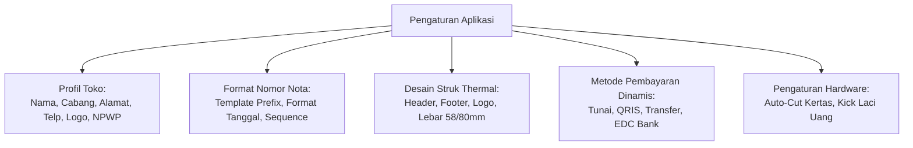

# 05. Mesin Kustomisasi Toko & Sistem Perpajakan

Dokumen ini menjelaskan dua pilar fleksibilitas sistem: **Mesin Kustomisasi Toko** yang memungkinkan aplikasi beradaptasi pada segala jenis toko ritel/grosir, dan **Mesin Perpajakan** yang mematuhi ketentuan perundang-undangan perpajakan.

---

## 1. Mesin Kustomisasi Toko (Full Store Customization)

Sistem dirancang dengan arsitektur konfigurasi dinamis berbasis tabel `app_settings` dan `payment_methods`:



### A. Profil Toko & Cabang
- **Informasi Bisnis**: Nama toko, nama cabang, slogan/tagline, alamat lengkap, nomor telepon/WhatsApp, email, dan akun media sosial.
- **Informasi Legal & Pajak**: NPWP Toko, NIB (Nomor Induk Berusaha), nama Pengusaha Kena Pajak (PKP).
- **Logo Toko**: Unggah logo toko (format PNG/JPG) yang otomatis dikonversi menjadi bitmap monokrom presisi untuk cetak struk thermal dan dokumen faktur A4.

### B. Format Nomor Nota & Faktur Dinamis (Pattern-Based Numbering)
Admin dapat mengatur formula penomoran nota/faktur/surat jalan:
- `INV/{BRANCH}/{YYYY}{MM}/{SEQ:5}` $\rightarrow$ Contoh: `INV/JKT/202610/00001`
- `FP/{YYYY}/{SEQ:4}` $\rightarrow$ Contoh: `FP/2026/0042`
- `SJ/{YYYY}{MM}{DD}/{SEQ:3}` $\rightarrow$ Contoh: `SJ/20261031/007`
- Parameter yang didukung:
  - `{BRANCH}`: Kode cabang toko
  - `{YYYY}`: Tahun 4 digit (2026)
  - `{YY}`: Tahun 2 digit (26)
  - `{MM}`: Bulan 2 digit (01-12)
  - `{DD}`: Tanggal 2 digit (01-31)
  - `{SEQ:n}`: Nomor urut otomatis dengan panjang $n$ digit
  - Opsi reset nomor urut: Setiap Hari, Setiap Bulan, atau Setiap Tahun.

### C. Kustomisasi Desain Struk & Hardware
- **Pilihan Lebar Kertas**: Kompatibel dengan thermal paper **58mm** (32 karakter/baris) dan **80mm** (48 karakter/baris).
- **Header & Footer Struk Bebas**:
  - Header: Pilihan tampilkan logo, nama toko, alamat, nomor telepon.
  - Footer: Catatan kaki kustom (misal: *"Barang yang sudah dibeli tidak dapat ditukar"*, info garansi, dan QR Code survey kepuasan pelanggan).
- **Opsi Hardware Otomatis**:
  - Buka laci uang kasir otomatis (*Auto-Open Cash Drawer via RJ11*).
  - Potong kertas otomatis (*Auto-Cutter*).
  - Cetak struk rangkap (1x untuk pembeli, 2x untuk arsip kasir).

### D. Manajemen Metode Pembayaran Bebas Tambah
Admin dapat menambah metode pembayaran baru secara bebas melalui antarmuka:
- Contoh: Menambah metode `"QRIS BCA"`, `"Transfer Mandiri"`, `"ShopeePay"`, `"Voucher Belanja"`.
- Setiap metode dapat dikonfigurasi apakah memerlukan input nomor referensi transaksi atau persentase biaya administrasi/MDR.

---

## 2. Mesin Perpajakan Komprehensif (Taxation Engine)

Sistem perpajakan dirancang mematuhi regulasi perpajakan di Indonesia (PPN 11%, rencana PPN 12%, PB1 Restoran 10%, serta Non-BKP Bebas Pajak):

```mermaid
flowchart LR
    TAX_CONFIG[Konfigurasi Tarif Pajak:\nPPN 11%, PPN 12%, PB1 10%] --> TAX_MODE{Mode Pajak?}
    TAX_MODE -->|Tax Inclusive| INC["Harga Termasuk Pajak\nDPP = Harga / (1 + Rate)\nPajak = Harga - DPP"]
    TAX_MODE -->|Tax Exclusive| EXC["Harga Belum Termasuk\nSubtotal + (Subtotal * Rate)\n= Grand Total"]
    
    INC --> PRODUCT_RULES[Aturan Pajak per Produk:\nKena Pajak (BKP) vs Bebas Pajak (Non-BKP)]
    EXC --> PRODUCT_RULES
    
    PRODUCT_RULES --> TAX_REPORT[Laporan Rekapitulasi Pajak:\nPPN Keluaran vs PPN Masukan]
```

### A. Dua Mode Perhitungan Pajak
1. **Pajak Termasuk dalam Harga (Tax Inclusive / Include)**:
   - Umum digunakan pada minimarket dan ritel modern di mana harga di rak merupakan harga bersih yang dibayar konsumen.
   - Contoh Tarif PPN 11%:
     - Harga di Rak: Rp 11.100.
     - Dasar Pengenaan Pajak (DPP): $\frac{\text{Rp 11.100}}{1 + 0.11} = \text{Rp 10.000}$.
     - Nilai PPN (11%): $\text{Rp 1.100}$.
     - Struk mencantumkan rincian: `DPP: Rp 10.000 | PPN: Rp 1.100 | Total: Rp 11.100`.
2. **Pajak Ditambahkan di Akhir Nota (Tax Exclusive / Exclude)**:
   - Umum digunakan pada transaksi grosir B2B atau restoran:
     - Subtotal belanja: Rp 100.000.
     - PPN (11%): Rp 11.000.
     - Total Akhir yang dibayar: Rp 111.000.

### B. Pengaturan Pajak per Item (BKP vs Non-BKP)
- Barang kebutuhan pokok (seperti beras, telur ayam, gula pasir curah) berstatus **Bebas Pajak (Non-BKP)**.
- Setiap produk memiliki toggle status:
  - `is_taxable: 1 / 0`
- Saat transaksi berlangsung, sistem hanya memungut pajak atas produk-produk yang ditandai kena pajak.

### C. Faktur Pajak Sederhana & Transaksi Grosir B2B
- Mendukung pencatatan **NPWP / NIK Pelanggan** untuk transaksi partai besar.
- Cetak Faktur Penjualan memuat:
  - Identitas PKP Penjual (Nama Toko, Alamat, NPWP).
  - Identitas Pembeli (Nama Toko Rekanan, Alamat, NPWP/NIK).
  - Rincian BKP, Nilai DPP, dan Nilai PPN yang dipungut.

### D. Rekapitulasi Pajak Masukan vs Pajak Keluaran
Sistem menyediakan laporan pajak terpadu untuk pembukuan dan pelaporan SPT Masa:
- **Pajak Keluaran**: Total PPN yang dipungut dari pelanggan saat penjualan.
- **Pajak Masukan**: Total PPN yang dibayar toko kepada pemasok saat pembelian stok barang.
- **Selisih PPN (Kurang/Lebih Bayar)**: $\text{PPN Keluaran} - \text{PPN Masukan}$.
- Ekspor rekapitulasi ke format Excel siap impor untuk pelaporan pajak.
