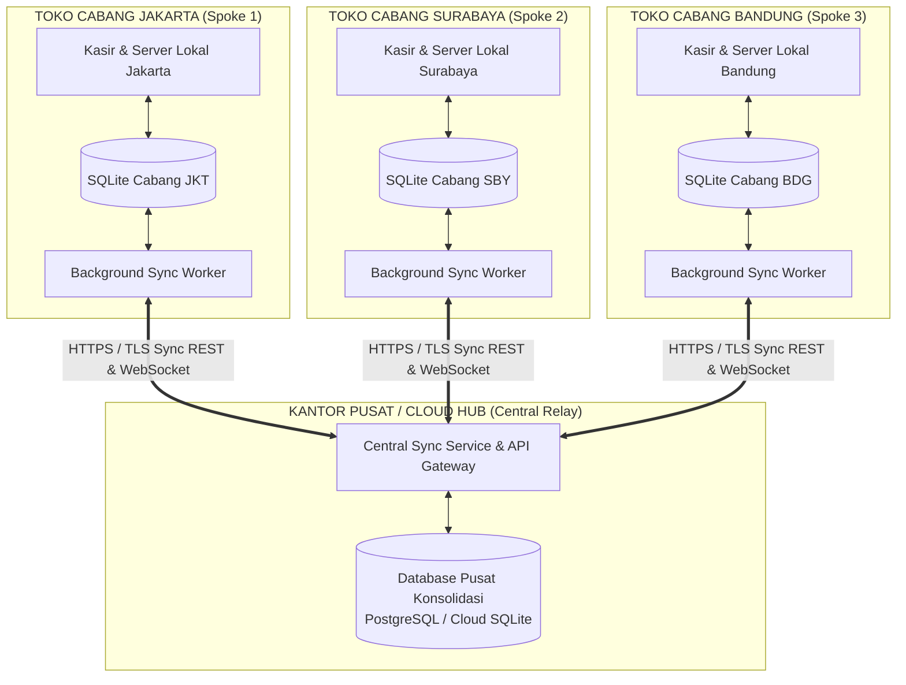
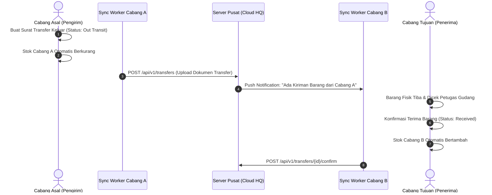

# 07. Sinkronisasi Antar Cabang (Multi-Branch Synchronization)

Dokumen ini menjelaskan arsitektur dan mekanisme sinkronisasi data antar cabang di lokasi geografis/kota yang berbeda tanpa mengorbankan kecepatan kasir lokal dan tanpa risiko macet saat internet padam.

---

## 1. Tantangan Toko Multi-Cabang & Solusi Arsitektur

Dalam bisnis ritel/grosir dengan banyak cabang di berbagai daerah:
- ❌ **Koneksi internet tidak selalu stabil 100%**: Jika kasir bergantung penuh pada koneksi langsung (*direct live connection*) ke database pusat via internet, maka kasir di cabang akan lumpuh total ketika koneksi ISP down atau lemot.
- ❌ **Latency jaringan WAN**: Query produk atau checkout yang harus bolak-balik ke server pusat di internet membutuhkan 150–500ms per klik, memperlambat antrean kasir.

### Solusi: **Arsitektur Hybrid Hub-and-Spoke (Offline-First Local + Asynchronous Cloud/VPN Sync)**

Setiap cabang tetap beroperasi secara mandiri dan cepat menggunakan **SQLite lokal (Edge)**, kemudian bertukar data secara berkala (*asynchronous background replication*) dengan **Kantor Pusat / Cloud Relay**:

---

## 2. Dua Arah Aliran Sinkronisasi (Two-Way Sync Flow)

### A. Hilir ke Hulu: Cabang $\rightarrow$ Pusat (Upstream Sync)
Data operasional harian cabang diunggah secara berkala ke pusat (misal setiap 1 menit atau saat ada koneksi internet):
1. **Transaksi Penjualan & Pembayaran**: Laporan omset per cabang terkumpul otomatis di pusat.
2. **Riwayat Shift & Mutasi Kas**: Catatan pembukaan/penutupan kasir dan pengeluaran operasional cabang.
3. **Data Pelanggan Baru**: Pelanggan yang didaftarkan di Cabang Jakarta langsung dapat dikenali saat belanja di Cabang Surabaya.
4. **Log Mutasi Stok Cabang**: Memastikan data stok di sistem pusat selalu ter-update mendekati realtime (*near real-time*).

### B. Hulu ke Hilir: Pusat $\rightarrow$ Cabang (Downstream Sync)
Data master dan kebijakan yang diatur oleh manajemen pusat didistribusikan ke seluruh cabang:
1. **Master Katalog Produk**: Penambahan produk baru atau perubahan nama barang.
2. **Kenaikan / Penyesuaian Harga**: Update harga eceran maupun grosir otomatis terunduh ke cabang.
3. **Promosi & Diskon Terpusat**: Pengaturan periode diskon atau voucher belanja serentak.
4. **Akun Pengguna & Otorisasi**: Penambahan akun kasir/supervisor dari pusat.

---

## 3. Strategi Mencegah Konflik Data (Conflict Prevention Strategy)

1. **Penggunaan Global UUID v4**:
   - Seluruh primary key (`id`) menggunakan UUID v4. Menghilangkan 100% risiko tabrakan ID antar cabang saat data disatukan di database pusat.
2. **Prefix Nomor Nota Berdasarkan Kode Cabang**:
   - Jakarta: `INV/JKT/202610/00001`
   - Surabaya: `INV/SBY/202610/00001`
   - Bandung: `INV/BDG/202610/00001`
   - Menjamin nomor nota selalu unik dan tidak akan pernah bentrok di level pusat.
3. **Delta Replication dengan Timestamp (`updated_at`) & Version Counter**:
   - Sinkronisasi hanya mengirim data yang berubah sejak sinkronisasi terakhir (`WHERE updated_at > last_sync_time`), sehingga sangat hemat kuota internet (hanya beberapa kilobyte per transaksi).
4. **Strategi Resolusi Konflik (Conflict Resolution)**:
   - *Master Data (Produk, Harga, Pajak)*: **Pusat Menang (HQ Wins)**. Cabang menerima data terbaru dari pusat.
   - *Transactional Data (Penjualan, Kasir)*: **Cabang Menang (Branch Authority)**. Cabang adalah sumber kebenaran (*source of truth*) untuk transaksi kasirnya sendiri.

---

## 4. Fitur Mutasi Stok Antar Cabang (Inter-Branch Transfer)

Bisnis multi-cabang membutuhkan fitur perpindahan stok barang (misal: Cabang Jakarta kehabisan stok Minyak Goreng, lalu meminta kiriman 20 Dus dari Cabang Bandung):

### Pengecekan Stok Cabang Lain (Cross-Branch Stock Inquiry):
- Kasir di Cabang Jakarta dapat menekan tombol `Cek Stok Cabang Lain` pada detail produk untuk melihat sisa stok di Cabang Surabaya dan Bandung secara langsung melalui query ringan ke API Pusat.

---

## 5. Dua Model Implementasi Jaringan Antar Cabang

Pengguna dapat memilih model infrastruktur sesuai skala anggaran bisnis:

### Opsi A: Model Cloud Hub Relay (Rekomendasi Skala Menengah - Besar)
- Menggunakan server VPS / Cloud murah (seperti DigitalOcean / AWS / IDCloudHost mulai Rp 50.000 - Rp 100.000/bulan) yang menjalankan service sinkronisasi terpusat.
- Cabang cukup terhubung ke internet standar (Indihome / Biznet / Modem 4G) tanpa perlu IP Public Static.
- Komunikasi dienkripsi menggunakan protokol **HTTPS / TLS + API Key + JWT Bearer Token**.

### Opsi B: Model Peer-to-Peer Mesh VPN (Zero Cloud Cost / Toko 2-3 Cabang)
- Tanpa sewa server cloud.
- Menghubungkan PC Kasir Utama di masing-masing cabang menggunakan teknologi **Mesh VPN Aman** (seperti **Tailscale** atau **WireGuard**).
- PC Kasir Utama di Kantor Pusat bertindak sebagai penerima data langsung dari PC Kasir Utama cabang-cabang lain melalui IP virtual privat (contoh: `100.x.x.x`).
- 100% gratis untuk jaringan bisnis kecil (hingga 3–10 perangkat).
